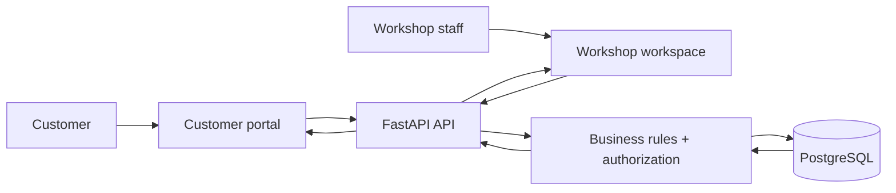

# AutoFix — Product Walkthrough

AutoFix is a full-stack automotive workshop platform for running the customer journey and the workshop journey in one connected product.

A customer can use the portal to view their vehicles, appointments, estimates, invoices, payments and service requests. The workshop team can manage customers, vehicles, bookings, check-ins, inspections, estimates, repair orders, quality control, invoices, payments, parts, purchase orders, suppliers, labour, staff, service requests and reporting.

This walkthrough is written for someone who is simply looking at the product and wants to understand what it does.

## The product at a glance

**Customer portal → service request → workshop queue → customer & vehicle → appointment → check-in → inspection → estimate → repair order → quality control → invoice → payment → parts & purchasing → reporting**

The product is connected end to end:

**User action → Next.js interface → FastAPI API → business rules → PostgreSQL → API response → updated interface**

That means the screens below are not isolated mockups. The customer and workshop views are backed by the same application data model.

## How the product works

## Workshop workspace

### Dashboard

The dashboard gives the workshop a quick view of current work and money flowing through the business.

### Attention centre

This is the operational inbox for items that need someone to act on.

### Customers

The customer directory is the main relationship record for people using the workshop.

### Diary

Appointments and scheduled workshop activity are managed from the diary.

### Check-ins

Check-in moves an incoming vehicle into the workshop's active operational flow.

### Inspections

Inspections capture the vehicle condition and the findings that inform repair decisions.

### Estimates

Estimates turn inspection findings and proposed work into something the customer can review before repair work proceeds.

### Repair orders

Repair orders connect approved work to the workshop execution stage.

### Quality control

Quality control provides the final operational check before work is considered ready to leave the workshop.

### Invoices

Invoices turn completed work into a customer-facing financial document.

### Payments

Payments track money received against workshop charges.

### Inventory

Inventory keeps the parts side of the operation visible to the workshop.

### Reports

Reports bring operational and financial activity together for management visibility.

## Customer and workshop handoff

### A customer creates a service request

A customer submits a request from the portal. The request is sent through the application's API and becomes part of the workshop's live service-request workflow.

### The workshop receives that request

The same request is visible to workshop staff in the service-request queue.

The important part is the handoff:

**Customer screen → API → PostgreSQL → API → workshop screen**

The customer and the staff member are not looking at two separate frontend-only copies of the data.

## Workshop operations around the core job

### Audit log

The audit area gives the workshop a history of important actions.

### Labour

Labour records capture the time and work performed by technicians.

### My work

Technicians can focus on the jobs and work assigned to them.

### Part requests

Technicians and workshop staff can raise and manage requests for parts needed on jobs.

### Parts

The parts catalog provides the workshop with its reusable parts and pricing data.

### Purchase orders

Purchase orders connect workshop demand to supplier purchasing.

### Service requests

The service-request queue is where workshop staff handle incoming customer work.

### Staff

Staff administration controls the people who can use the workshop system.

### Suppliers

Supplier records keep purchasing relationships organized.

### Vehicles

Vehicles are tracked independently so workshop work stays attached to the right car.

## Customer portal

The customer portal is a separate user experience over the same backend. Customers see the information relevant to them without being exposed to internal workshop administration.

### Customer home

The portal home gives the customer a simple summary of what is happening with their vehicles and work.

### Appointments

Customers can see what the shop has booked for them.

### Estimates

Customers can review estimates and understand what work has been proposed.

### Invoices

Customers can review what the shop has billed them.

### Payments

Customers can see their payment history and the financial state of their work.

### Service requests

Customers can see requests they have made and follow their progress.

### Vehicles

Customers can see the vehicles attached to their account.

## A real persistence example

One of the clearest product behaviors is customer creation.

A staff member can create a customer, move away from the record, search for it again, open the customer detail and reload the page. The information remains because it was persisted by the backend rather than held only in the browser.

The same principle is used throughout the product:

**Create or change something in the UI → backend processes it → PostgreSQL stores it → another screen reads it back**

## Feature map

| Area | What it is for |
|---|---|
| Dashboard | Overall workshop and financial view |
| Attention | Work that needs action |
| Customers | Customer records |
| Vehicles | Vehicle records |
| Appointments | Booking and diary |
| Check-ins | Vehicle arrival and intake |
| Inspections | Vehicle findings |
| Estimates | Proposed repair work |
| Repair orders | Workshop execution |
| Quality control | Final operational checks |
| Invoices | Billing |
| Payments | Money received |
| Inventory | Parts availability |
| Parts | Parts catalog |
| Part requests | Requests for needed parts |
| Purchase orders | Supplier purchasing |
| Suppliers | Supplier records |
| Labour | Technician time and work |
| My work | Individual technician workload |
| Service requests | Incoming customer work |
| Staff | User administration |
| Audit | Activity history |
| Reports | Operational and financial visibility |
| Customer portal | Customer-facing experience |

## Technology

**Frontend:** Next.js, React, TypeScript

**Backend:** FastAPI, Python

**Database:** PostgreSQL

**Data access:** SQLAlchemy async

**Authentication & authorization:** authenticated sessions with backend permission checks

**Browser experience:** responsive staff workspace plus a dedicated customer portal
